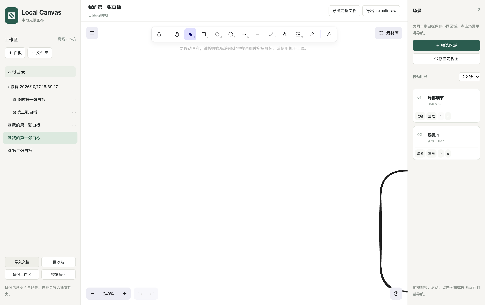
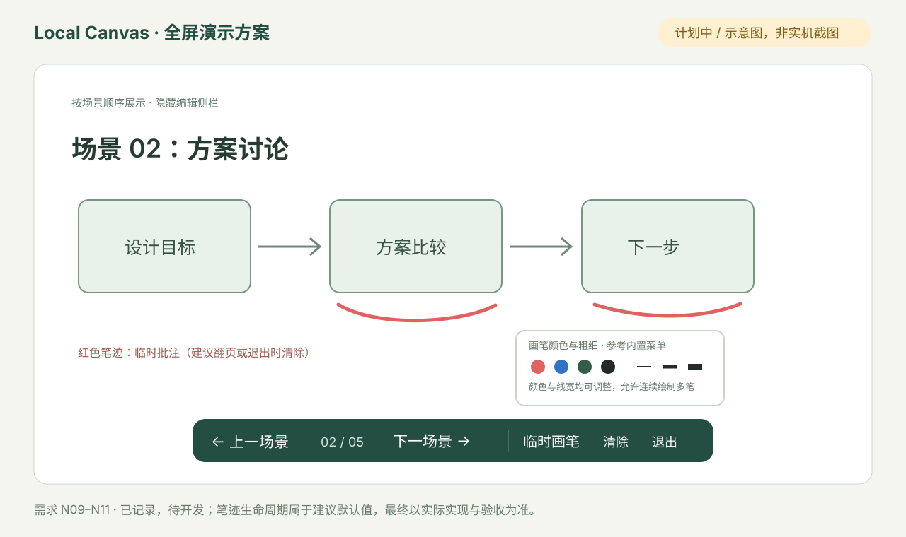

# Local Canvas · 本地无限画布

基于官方 MIT 授权的 **Excalidraw React 组件 + React + Electron + SQLite**，面向 Windows/macOS 的本地优先白板。此 fork 的重点是本地多文档管理、可靠保存和同一白板内的场景导航。

**当前状态：P0 可运行开发版。** 已验证 macOS Apple Silicon；Windows 实机验证与发布签名待完成。以下“待开发”内容是用户需求记录，不代表当前应用已具备。

[开发源码与运行说明](https://github.com/layzerff/excalidraw/tree/codex/local-canvas-p0/desktop) · [完整需求与验收](https://github.com/layzerff/excalidraw/blob/codex/local-canvas-p0/desktop/NEXT-ITERATION.md) · [测试记录](https://github.com/layzerff/excalidraw/blob/codex/local-canvas-p0/desktop/VALIDATION.md) · [原版说明](README.upstream.md)

## 当前版本实机界面



*2026-10-17，macOS 打包应用的真实回归测试截图。恢复文件夹与重复标题来自导入/备份恢复测试；截图仍显示场景尺寸和旧间距，紧凑列表等改动尚未实现。*

### 已确认问题：原生手写字体加载失败 · 待修复


*用户反馈参考图，不是修复后的实机截图；仅凭此图不确定具体字体名称。*

隔离 Electron 检查已复现：Excalifont 与 Virgil 加载 `ABCabc` 时均报网络加载错误，虽然字体文件已经打包；需修复离线字体资源加载。旧版 Virgil 在官方 0.18.1 中还被标记为旧字体，当前未显式开启其菜单显示。已记录为 **N12 优先修复项**：恢复原生手写效果、保留标准字体和旧文档兼容，再推进自定义字体。当前开发包尚未修复。

## 与原版 Excalidraw 的区别

比较对象是本仓库保留的上游开源项目及本桌面开发版，不是 Excalidraw+ 商业套餐。绘图能力来自官方组件；下表仅说明此 fork 的集成与扩展。

| 方面 | 上游开源项目 / 组件 | Local Canvas 当前开发版 |
| --- | --- | --- |
| 使用形态 | 官方编辑器组件及 Web 应用代码 | 新增 Electron 本地桌面外壳，入口为 `desktop/` |
| 原生绘图 | 图形、文字、箭头、自由画笔、Frame、撤销重做等 | 保留官方组件；已实测矩形与撤销重做，其他原生功能继续回归 |
| 文档与文件夹 | 组件不提供本产品所需的桌面文档工作区 | 新增嵌套文件树，创建、重命名、移动、切换与回收站；无文档数量配额 |
| 本地保存 | Web 应用有浏览器本地保存；组件由宿主负责持久化 | 新增 SQLite WAL、版本冲突保护、切换/关闭前保存及重启恢复 |
| 备份 | 原生 .excalidraw 等开放格式 | 增加完整文档与工作区备份，包含图片、场景与文档素材库；恢复导入新文件夹 |
| 场景区域导航 | Frame 与官方视口 API 是可用底层能力 | 新增独立场景列表、区域框选、保存视图、标题、基础排序、区域重框与可打断移动缩放 |
| 素材库 | 官方组件支持素材库 | 保留素材库及文档内持久化；第三方本地库待专项验收，在线浏览/安装未开放 |
| PDF / 演示 | 此处不对上游全部版本作功能断言 | 本桌面版尚未实现 PDF 导出及全屏场景演示，已列入下方计划 |
| 网络服务 | 官方 Web 应用具有网络协作等能力 | 当前桌面版禁止远程请求和弹窗，离线使用；未接入 Excalidraw+ 服务 |

## 下一批修改清单

所有用户反馈均在此累计；实施后会更新状态、实际截图和验证结果。

| 编号 | 修改要求 | 状态 |
| --- | --- | --- |
| N01 | 移动时长新增 **0.5 秒** | 已记录，待开发 |
| N02 | 去掉场景条目的宽 × 高描述 | 已记录，待开发 |
| N03 | 缩小场景行距、卡片和操作区，采用紧凑列表 | 已记录，待开发 |
| N04 | 场景自由拖动排序，完善插入提示、首末位落点与长列表滚动 | 已有基础拖拽；完善交互与真实拖拽测试待完成 |
| N05 | 参考 Revezone 改善中英文字体，评估界面与画布自定义字体 | 已评估，待开发；具体字体尚未指定 |
| N06 | 导出可选 PDF；建议完整白板单页 / 按场景顺序分页 | 已记录，待开发；分页方式为建议方案 |
| N07 | 右侧场景列表可隐藏和重新显示，画布回收空间 | 已记录，待开发 |
| N08 | 第三方素材库兼容确认，完善本地导入与持久化验证 | 组件有本地库基础，专项验收待完成；在线安装未开放 |
| N09 | 场景列表增加“演示”按钮，进入全屏演示 | 已记录，待开发 |
| N10 | 全屏底部显示上一场景、下一场景及临时画笔按钮 | 已记录，待开发 |
| N11 | 临时画笔可改颜色与笔画粗细，参考内置画笔风格和菜单 | 已记录，待开发 |
| N12 | 恢复原生 Excalidraw 手写字体，保留手写/标准字体选择及旧文档兼容 | 已复现加载故障，优先待修复；同时评估旧版 Virgil 菜单入口 |

### 全屏演示方案示意 · 尚未实现



“临时画笔”暂建议为：允许连续绘制多笔，翻页或退出演示时清除，不写入原文档、备份或 PDF。**这是建议默认规则，用户尚未明确指定其生命周期。** 图中“页码、清除、退出”入口也是建议设计，不是现有功能截图。

## 运行开发版

应用源码目前在 `codex/local-canvas-p0` 分支；默认 `master` 分支先同步说明与图片，应用代码尚未合并。

```sh
git clone --branch codex/local-canvas-p0 https://github.com/layzerff/excalidraw.git
cd excalidraw/desktop
npm ci --workspaces=false
# 若 npm 没有下载 Electron 运行时：
node node_modules/electron/install.js
npm run build
npm start
```

存储测试需要 Node 24.13+ 或 Node 26。Electron 自带运行时。当前包未签名或公证，不是正式发布安装包。

已通过 9 项存储/导航单元测试，以及源码运行和 macOS 打包应用的真实 Electron 回归，覆盖绘图、撤销重做、场景、文档切换、导入导出、备份恢复和关闭前保存。Windows、IME/手写笔及全部原生功能的完整回归仍待完成。细节见[验证记录](https://github.com/layzerff/excalidraw/blob/codex/local-canvas-p0/desktop/VALIDATION.md)。

## 更新记录与同步约定

| 日期 | 更新 |
| --- | --- |
| 2026-10-17 | 提交首个桌面开发里程碑 `668e9f8` |
| 2026-10-17 | 收录场景列表、字体、PDF、侧栏与素材库需求 N01–N08 |
| 2026-10-17 | 补充全屏演示及临时画笔需求 N09–N11 |
| 2026-10-17 | 更新 fork 首页 README：实机截图、原版差异表、完整需求状态和演示示意 |
| 2026-10-17 | 新增 N12 原生手写字体恢复需求、用户参考图与已复现的字体加载故障记录 |

后续每次在本项目中处理用户新增需求或功能修改时，同步 README、详细需求文档与相关图片。新增需求标为待开发；实现后记录实际行为和测试证据，再更新状态。默认分支同步文档，开发分支保留对应源码。同步发生在处理项目请求时，不是后台定时任务。

## 上游与许可证

感谢 [Excalidraw](https://github.com/excalidraw/excalidraw)。保留上游 [MIT LICENSE](LICENSE)，第三方依赖与字体声明随桌面构建生成。原版介绍保存在 [README.upstream.md](README.upstream.md)。本项目当前没有接入 Excalidraw+ 付费服务。
