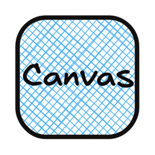
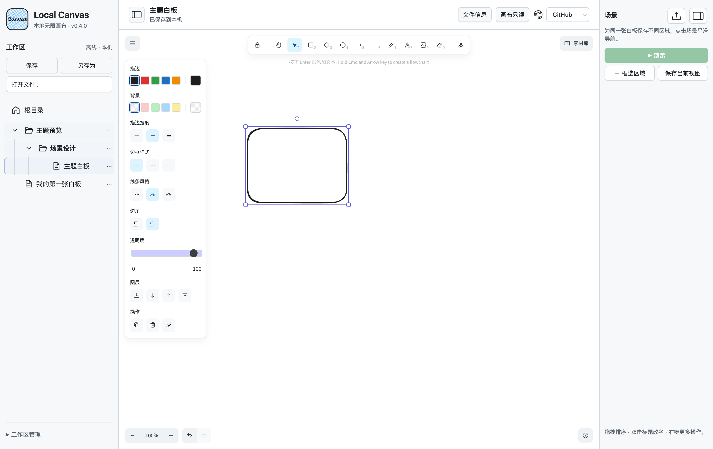
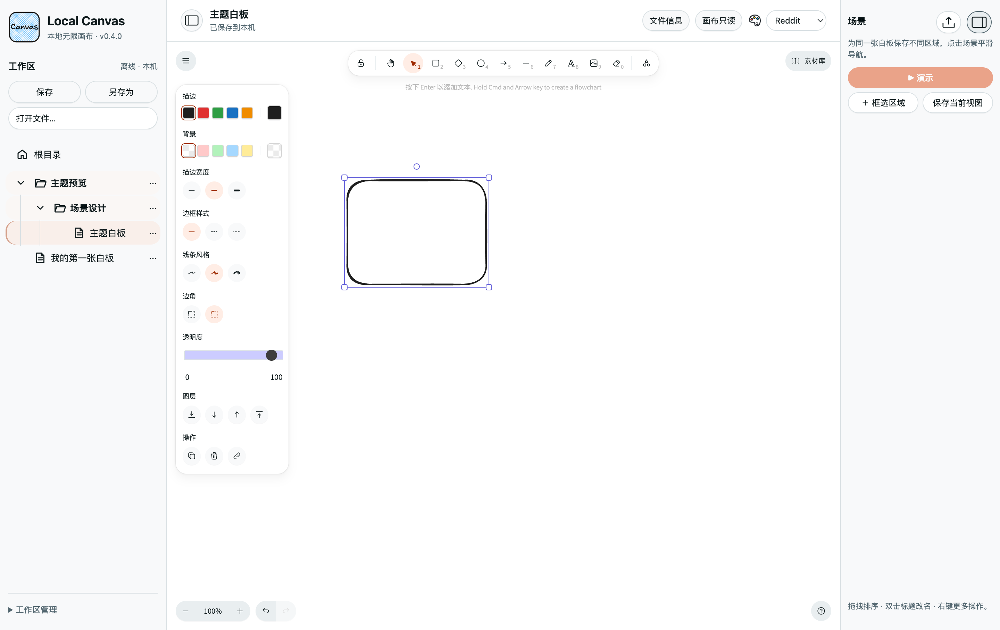
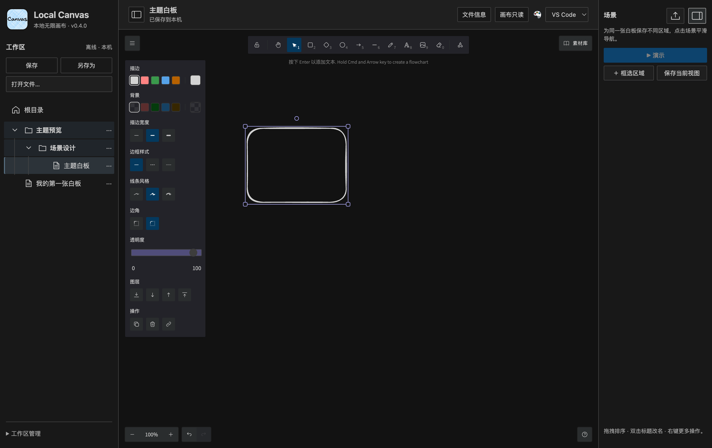
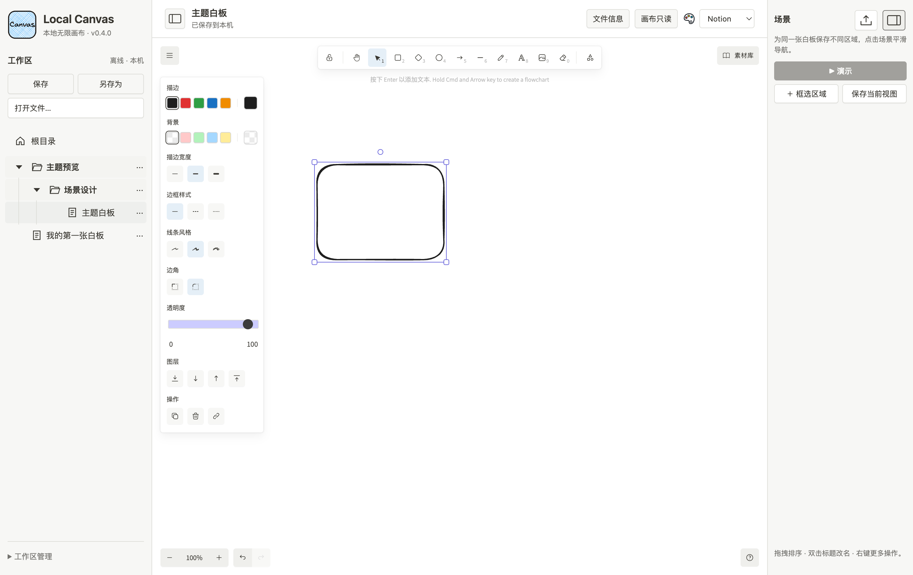
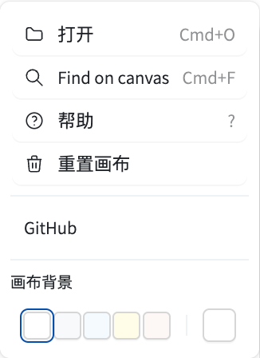
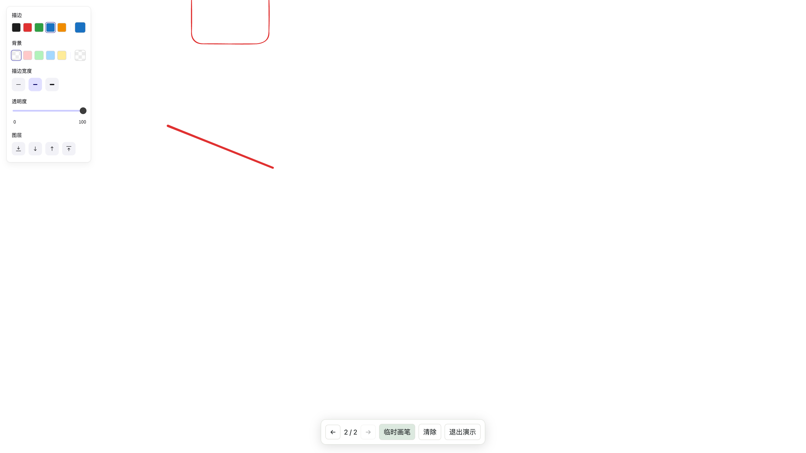
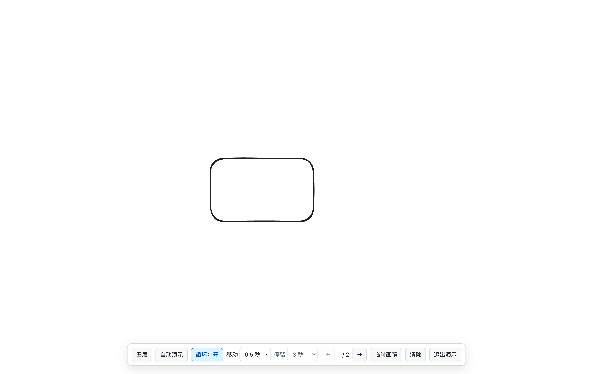
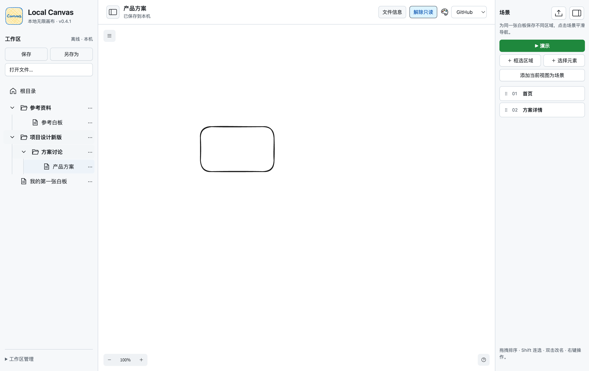
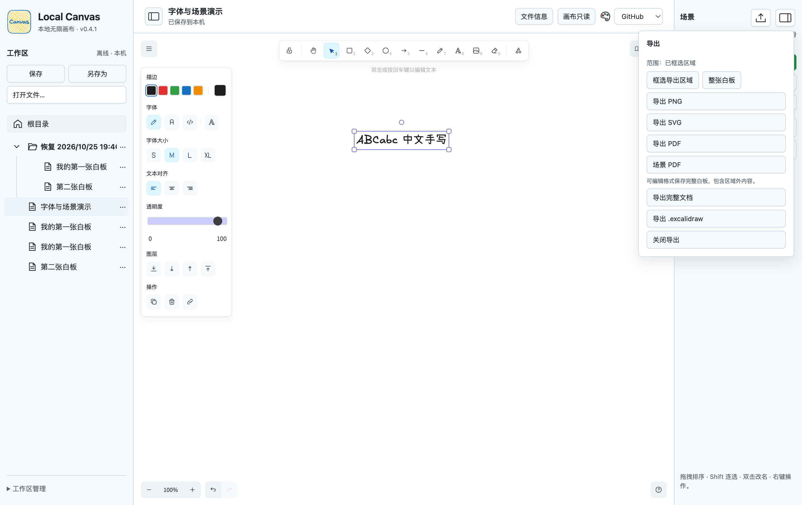

# Local Canvas · 本地无限画布

基于官方 MIT 授权的 Excalidraw React 组件，使用 React + Electron + SQLite 构建 Windows/macOS 本地优先白板。在保留原生绘图体验的基础上，增加本地文档管理、场景导航与全屏演示。

[开发源码与运行说明](https://github.com/layzerff/excalidraw/tree/codex/local-canvas-p0/desktop) · [修改清单](https://github.com/layzerff/excalidraw/blob/codex/local-canvas-p0/desktop/NEXT-ITERATION.md) · [更新记录](https://github.com/layzerff/excalidraw/blob/codex/local-canvas-p0/desktop/CHANGELOG.md) · [验证记录](https://github.com/layzerff/excalidraw/blob/codex/local-canvas-p0/desktop/VALIDATION.md) · [原版介绍](README.upstream.md)

## 与原版的区别

比较对象为上游开源编辑器及组件。原生绘图、文字、箭头、自由画笔、Frame 和撤销重做继续由官方组件提供。

| 功能 | Local Canvas 的扩展 |
| --- | --- |
| 本地文档工作区 | 根目录/文件夹右键新建，文件树就地菜单改名与移动，支持拖入文件夹及拖回根目录；文件夹加粗与折叠，左右侧栏可调整宽度 |
| 保存与备份 | 内容变更自动保存，平移、缩放和场景导航不触发写入；手动保存（Cmd/Ctrl+S）同时记录当前视图；完整备份包含图片、场景及素材库 |
| 同一白板内的场景 | 框选区域或保存当前视图，编辑标题、调整区域、拖动排序；点击后平滑移动并缩放，动画可打断 |
| 紧凑场景侧栏 | 单行标题、拖动排序，右键进入改名/重框等操作；标题原位编辑，双栏图标切换显示 |
| 导航时长 | 编辑侧栏固定 0.5 秒；演示中的手动翻页与自动播放可选 0.5、1、1.5、2 秒 |
| 全屏场景演示 | 从排序第一项开始，底部手动翻页或自动演示；图层面板可拖拽排序、右键原位改名，退出恢复编辑视图 |
| 循环演示与只读浏览 | 自动演示可开启循环，末页回首页继续；独立“画布只读”禁止元素编辑、拖动和删除，同时允许平移缩放，保留原生工具锁的连续绘制语义 |
| 四种工作区主题 | GitHub、Reddit、VS Code、Notion 风格，分别调整图标、配色与控件；目录高亮保持柔和，固定彩色调色板切换主题并记住偏好 |
| 更简洁的浏览界面 | 左右侧栏可独立隐藏，标题/保存状态与操作按钮分区；双击鼠标中键恢复 100% 缩放；精简画布菜单与帮助页外链 |
| 文件打开与保存 | 系统窗口选择文件，手动保存写回原文件；另存为选择新位置，“文件信息”查看路径。内容自动保存到本机恢复副本，外部文件变更时拒绝覆盖 |
| 演示临时画笔 | 直接使用 Excalidraw 原生自由画笔和样式面板，支持描边、背景、粗细及透明度；翻页或退出清除 |
| 集中导出 | 右上角统一入口，可框选区域导出 PNG、SVG、PDF；支持整板、场景分页 PDF 及完整可编辑文档 |
| 字体与素材库 | 沿用画布原生字体面板，支持手写字体及离线中文回退；本地 `.excalidrawlib` 导入、合并及随文档保存 |
| 离线使用 | 编辑器资源与字体随包提供，无需连接 Excalidraw+；当前未开放云同步及在线素材库安装 |

## 编辑与场景管理

当前桌面版本：**0.4.0**。新增四种主题、独立侧栏开关与 100% 缩放操作，统一顶部排布和目录字号。保留原生绘图、文件管理、保存、场景与演示能力。



| GitHub | Reddit |
| --- | --- |
|  |  |
| **VS Code** | **Notion** |
|  |  |

四种风格各有目录图标、控件圆角与配色；目录选中和祖先路径采用低对比度背景，主题入口始终使用同一枚彩色调色板。只借鉴视觉风格，不代表与上述产品存在合作关系。

左上角双栏按钮隐藏/显示文件栏，右上角按钮独立控制场景栏。画布双击鼠标中键恢复 100% 并保留视图中心，不触发内容自动保存。画布菜单保留打开、查找、帮助、重置、深色模式、背景及本项目 GitHub；保存和导出沿用工作区入口。



帮助页已去除顶部四个外链按钮，快捷键沿用原生平台判断：Mac 显示 Cmd/Option，Windows 显示 Ctrl/Alt。Mac 实机与模拟 Win32 平台标签已检查，Windows 实机键盘验证仍待完成。

三点菜单只显示清楚分组的操作项。选择重命名或移动后才显示对应表单，输入与确认按钮分区；选择移动目标不会立即执行，回收站操作需确认。

| 操作列表 | 重命名表单 | 移动表单 |
| --- | --- | --- |
|  |  |  |

设计参考：[Primer ActionMenu](https://primer.style/product/components/action-menu/)、[Primer 色彩用法](https://primer.style/product/getting-started/foundations/color-usage/)。本项目 GitHub 菜单由系统浏览器打开；画布不连接远程编辑服务。

[演示面板统一字号实机截图](docs/local-canvas/presentation-fonts.png)

## 全屏演示



临时画笔允许连续书写多笔，翻页及退出时清除；不写入文档、备份或 PDF。编辑和备份仍使用完整文档或 `.excalidraw` 格式。



自动演示每页停留可选 1、2、3、5、10、15、30 秒（默认 3 秒），与移动时长分别设置。循环默认关闭：关闭时到末页停止，开启时自动回到首页继续；记住开关偏好，但不会在重启后自行播放。打开图层面板或启用临时画笔时暂停自动播放。



## 区域导出



PNG、SVG、PDF 支持指定区域。PDF 以高分辨率图像嵌入页面；完整文档和 `.excalidraw` 保存整张白板，保留可编辑内容。

## 运行

应用代码位于 `codex/local-canvas-p0` 分支，默认分支同步说明与图片。

```sh
git clone --branch codex/local-canvas-p0 https://github.com/layzerff/excalidraw.git
cd excalidraw/desktop
npm ci --workspaces=false
npm run build
npm start
```

当前为开发版，已在 macOS Apple Silicon 验证；Windows 实机验证、发布签名及完整输入法/手写笔回归待完成。Revezone 风格的任意自定义字体上传仍在后续清单，当前提供原生中英文字体。具体完成范围见[修改清单](https://github.com/layzerff/excalidraw/blob/codex/local-canvas-p0/desktop/NEXT-ITERATION.md)。

Windows x64 安装版（NSIS）与免安装版已完成交叉构建及包完整性检查，内容与当前开发分支一致；尚未在 Windows 实机启动，也未进行 Windows 代码签名。界面截图来自 macOS 打包应用测试。

## 上游与许可证

感谢 [Excalidraw](https://github.com/excalidraw/excalidraw)。保留 [MIT LICENSE](LICENSE)；第三方依赖及字体声明随桌面构建生成。
