# Local Canvas · 本地无限画布

基于官方 MIT 授权的 Excalidraw React 组件，提供 Windows / macOS 本地工作区，以及可部署到 NAS 的网页版。

[下载 v0.5.0](https://github.com/layzerff/excalidraw/releases/tag/v0.5.0) · [完整更新清单](https://github.com/layzerff/excalidraw/blob/codex/local-canvas-p0/desktop/CHANGELOG.md) · [运行与开发](https://github.com/layzerff/excalidraw/tree/codex/local-canvas-p0/desktop) · [NAS 部署](https://github.com/layzerff/excalidraw/blob/codex/local-canvas-p0/desktop/web/README.md)


## 与 Excalidraw 开源编辑器的区别

在原生画布之外，增加本地文档管理、可跟随元素的场景、全屏演示、相对字号与填充密度、自动整理、自增球标、统一素材管理、WebDAV 备份及 NAS 网页工作区。


## 本地文档与可靠保存

### 文件树与目录排序

根目录或文件夹右键新建；就地菜单改名、移动，支持拖拽移入文件夹及根目录。目录可自定义拖拽、按名称或创建时间排序，长标题不会挤压图标。


### 自动保存、手动视图保存与另存为

文字、图形、颜色等内容变更自动保存；平移、缩放和场景导航不触发内容写入。Cmd/Ctrl+S 同时记录当前视图并写回关联文件；另存为可选择位置，“文件信息”查看路径，工作区也可迁移。

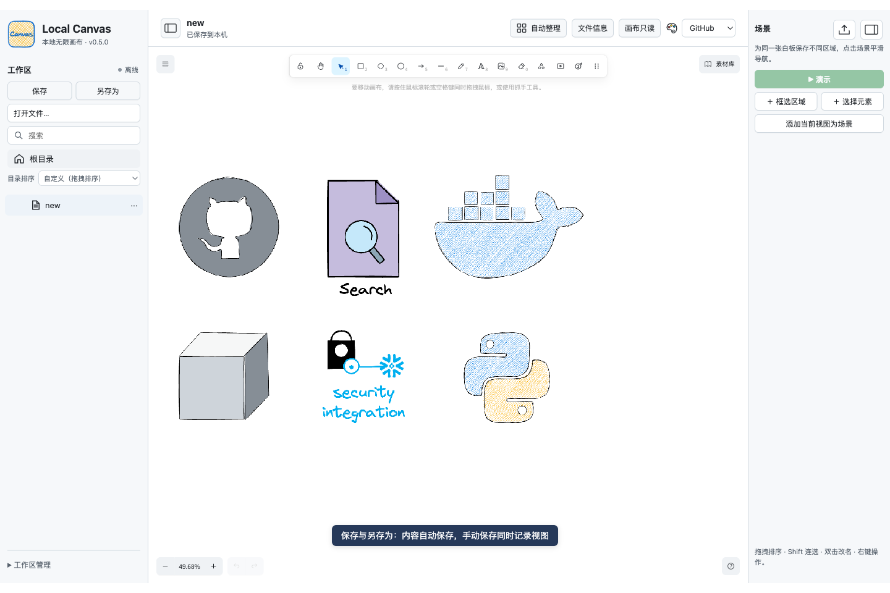

## 场景与全屏演示

### 三种创建场景的方法

框选区域、保存当前视图、选择独立元素或组合。编辑侧栏的导航固定为 0.5 秒，平滑移动和缩放可被操作打断。


### 元素跟随、重框和重建跟随

关联元素移动或改变边界后，场景自动更新。右键重框可解除跟随，也可按当前选择重建跟随；删除关联内容时联动移除场景，首次可提示并记住偏好。

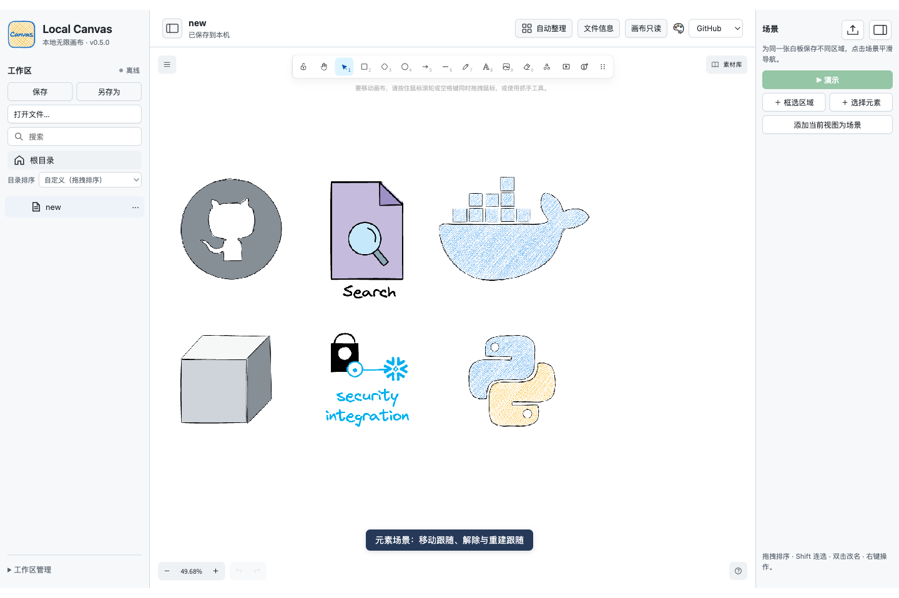

### 紧凑场景列表与批量操作

标题直接编辑，拖动调整顺序；Shift 连续多选，右键批量删除前明确确认。删除导航区域不会删除画布图形。


### 全屏、自动演示与循环

从首页进入，手动翻页或自动演示；移动时长 0.5 / 1 / 1.5 / 2 秒，停留时间独立设置。支持循环和图层面板中的顺序、标题管理，退出恢复编辑视图。


### 原生风格的临时画笔

沿用原生描边、颜色、粗细、透明度、边框与线条风格，提供填充密度。翻页或退出时清除，不写入白板、备份或导出。

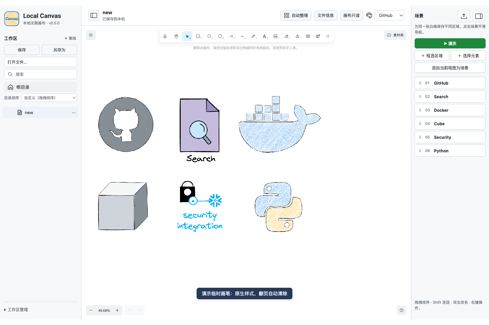

## 绘图与文字增强

### 相对字号滑块与紧凑数字输入

保留 S / M / L / XL，在底部增加 10–100% 比例滑块和数字框，支持 Tab 输入。绑定文字按容器空间适配；自由文字按当前尺寸比例调整，后续文字继承实际字号。

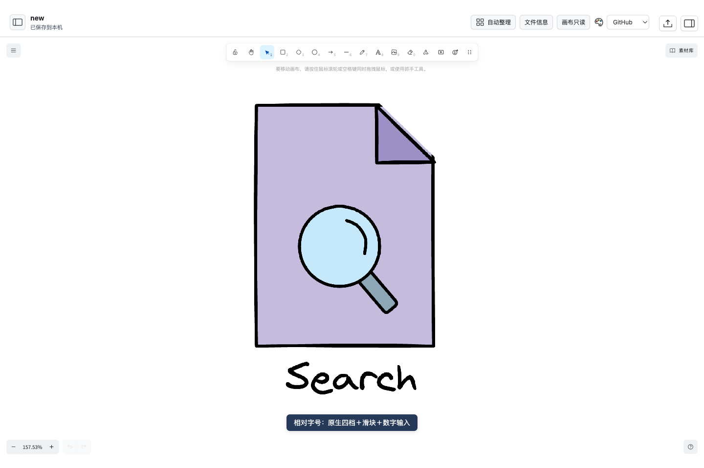

### 填充密度连续调节

调节斜线与交叉线的疏密，实心始终铺满，尺寸与位置不变。同类图形继承密度，球标独立记忆；演示临时画笔同样适用。

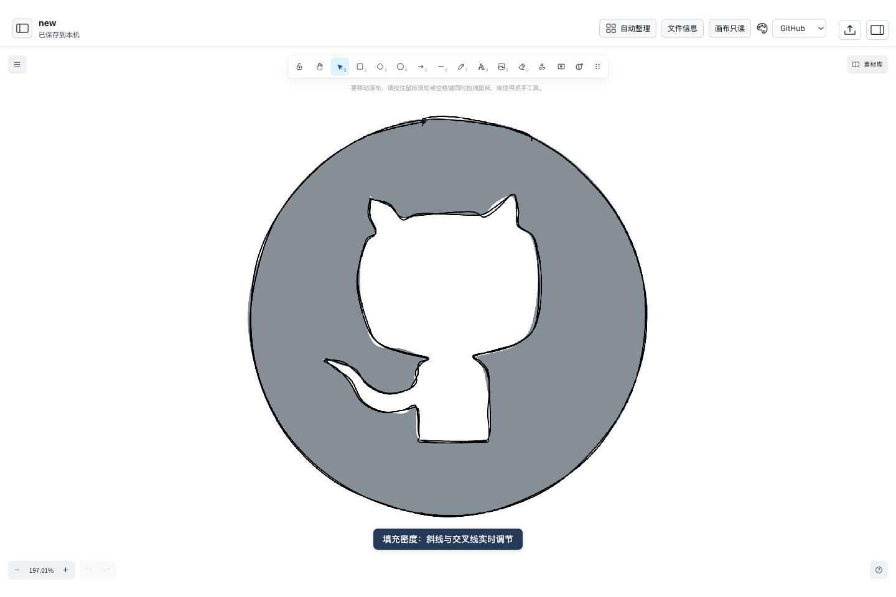

### 等距自动整理

框选或使用当前选择，进行纵向、横向、阵列整理，设置间隔；组合和绑定文字一起移动，可一键添加到跟随演示列表。


### 自增球标

点击画布连续放置圆圈数字，从 1 开始；可修改下一编号。使用原生字体和形状样式，手动调整大小后后续球标继承，保持正圆。

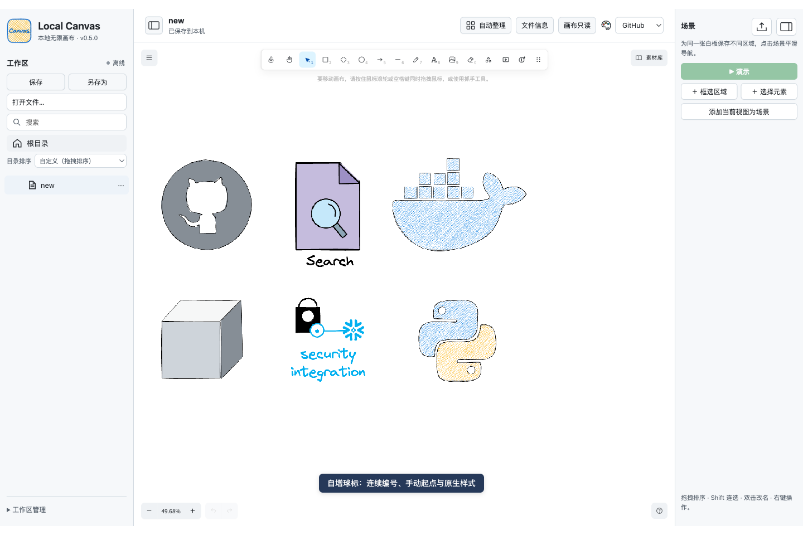

## 导航、界面与导出

### 文字、拼音与首字母搜索

左侧独立搜索，匹配文字在画布与列表中高亮，点击定位并选中；支持中文全拼、首字母和混合拼音，Cmd/Ctrl+F 聚焦。


### 全览与快速定位

双击中键按全部内容边界全览，不受固定最低比例限制；抓手平移后再次双击恢复编辑比例，右键保留当前视图。后续滚轮连续缩放，步长可在设置中选择。


### 六主题与可伸缩侧栏

GitHub、Reddit、VS Code、Notion、WeChat、Discord 风格，图标、色阶和柔和高亮分别适配。左右侧栏独立隐藏、显示并拖动宽度。


### 工具栏排序与独立只读

开启排序后拖动绘图图标，重启保留。画布只读禁止元素编辑、移动和删除，保留平移缩放；原生工具锁仍表示连续绘制。

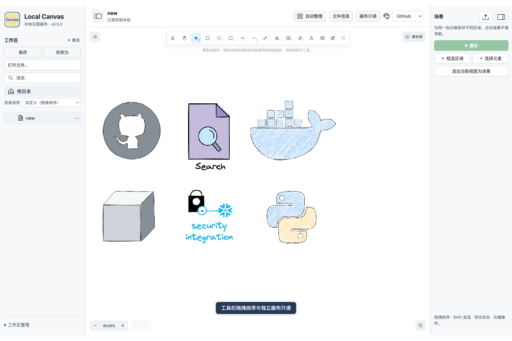

### 集中导出与区域选择

右上角统一导出 PNG / SVG / PDF，可指定区域、整张白板或场景分页 PDF。完整文档和 .excalidraw 保留可编辑内容与场景。

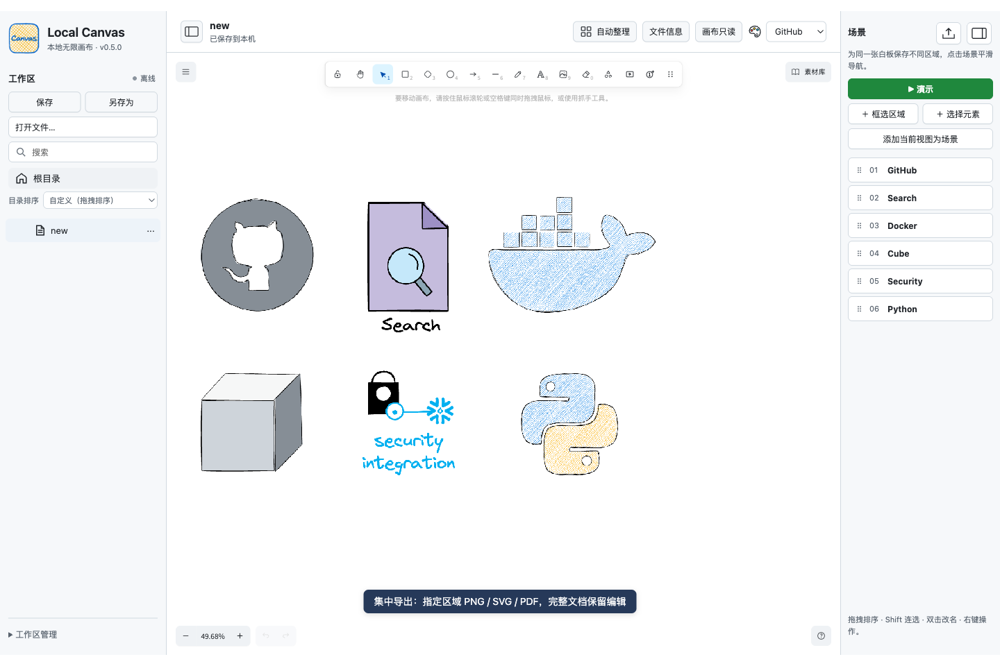

## 本地与在线素材库

### 逐个素材搜索与自动排列

统一搜索本地及在线每个素材的名称、标签和内部文字，分区显示，并保留在线加载进度。Ctrl＋滚轮调预览大小，自动增加或减少列数，最小与 Logo 相当。


### 在线素材包与离线使用

展开官方目录的素材包，显示缩略图；标题滚动冻结以便收起。素材可拖入画布，保存到本地后离线使用，面板仅手动关闭。也可在系统浏览器打开网页素材库，下载导入或确认安装回传。


### 本地文件夹与素材保存位置

只有“本地素材库”和“Excalidraw 在线素材库”两个可折叠根目录。右键创建、改名、删除分类文件夹（保留素材），多选移动、导出或确认删除；查看默认 / 当前保存路径并安全迁移，原文件保留。


## 网页、视频、备份与 NAS

### 通用 HTTPS 网页嵌入

自己的网页、NAS 页面和允许嵌入的网站可作为原生图元拖动、缩放与删除。重开文档先询问加载，保留沙箱、权限和本地文件隔离；网站禁止嵌入时可在浏览器打开。

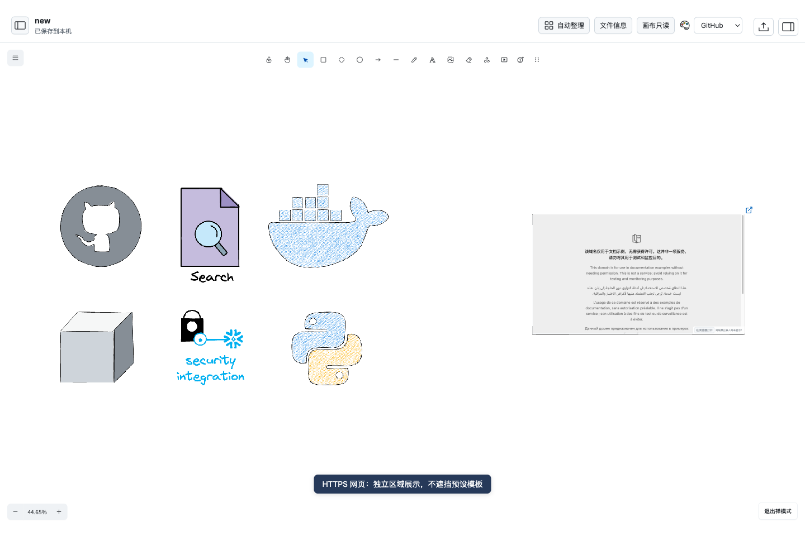

### 独立视频区与场景自动暂停

YouTube / Bilibili 使用专门播放器，编辑与演示可播放、暂停和调整进度。播放中切换场景会自动暂停。动图中的视频位于模板以外的独立区域，演示时居中放大。

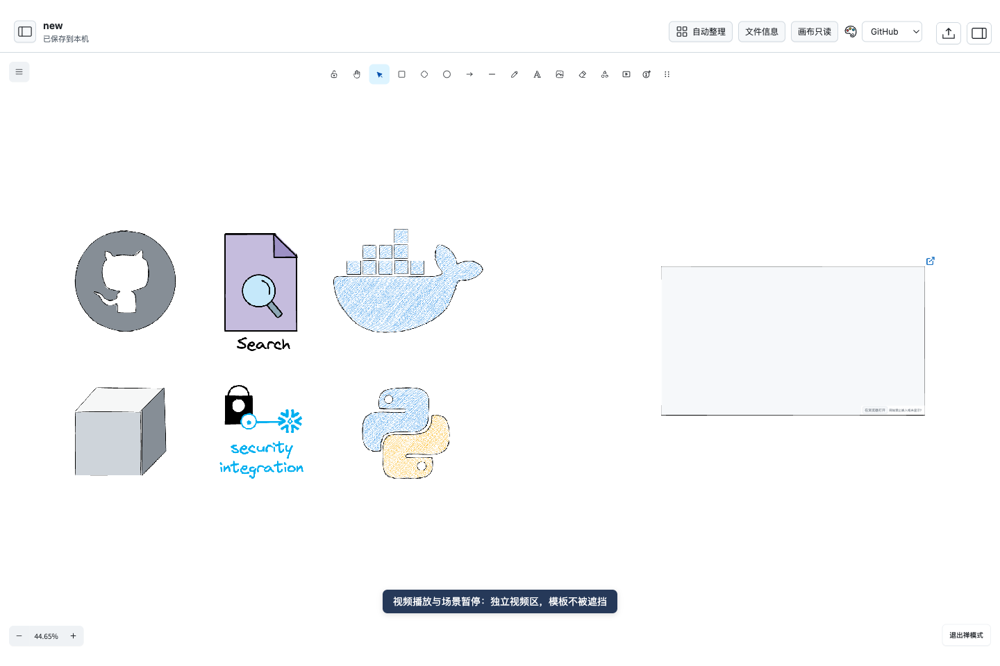

### WebDAV 设置、状态与手动备份

设置提供说明气泡，凭据加密保存；灰灯 / 绿灯反映 WebDAV 实际验证结果，状态下拉可查看连接并手动上传完整备份。演示使用本机 WebDAV 测试端点。


### NAS 网页版

浏览器打开完整白板，服务端 SQLite 保存文件树、图形、场景和素材，刷新可恢复。提供登录保护、导入导出、备份与 Docker / Node 部署文件。动图为本机服务，实际 NAS 配置见部署文档。

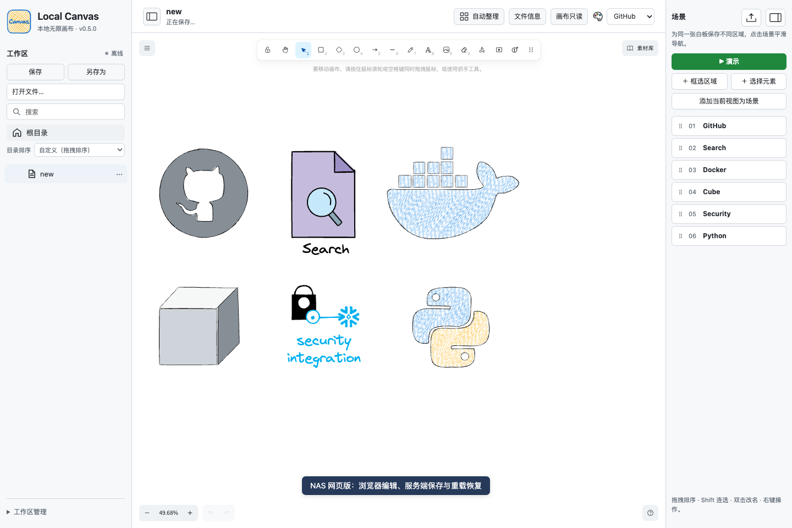

### 中英界面与正式 / 测试更新渠道

Logo 打开设置；简体中文 / 英文同时覆盖应用外层与原生画布。可保存缩放步长、只读、动画等偏好，检查 GitHub 正式 / 测试更新，可选下载并校验 SHA-256。

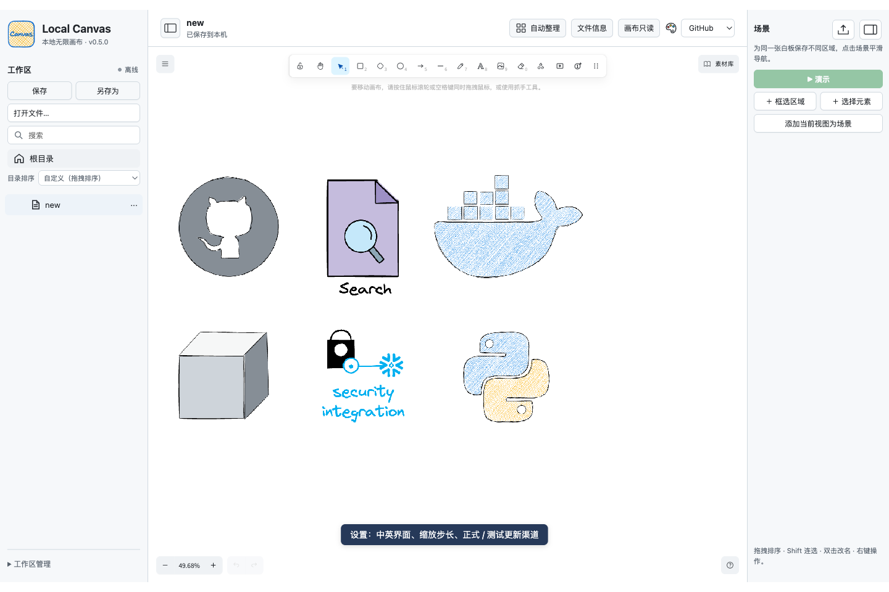

## 使用边界与部署

- macOS 提供 Apple Silicon ZIP，Windows 提供 x64 安装版与免安装版；包内含离线字体和编辑资源。Mac 为临时完整性签名，未公证；Windows 未进行 Authenticode 签名，Windows 与真实 NAS 仍需实机验收。
- 视频受网络、地区和平台嵌入许可影响；普通网页不能统一保证自动暂停。网页版 Bilibili 切场景会重载停止播放，进度可能重置。PDF 是栅格页面，图片 / PDF 不携带交互网页或可播放视频。
- WebDAV 是手动备份与恢复，不是双向同步或多人协作。桌面与 NAS 数据库独立，可用完整文档 / 备份迁移。NAS 需持久化 `/data`，公网访问应使用 HTTPS。
- 在线素材首次逐包建立本次会话索引，关键词在本地匹配；缺少名称的条目依靠已有文字 / 标签，不提供图像语义搜索。请分别遵守社区素材许可。
- 演示临时画笔快捷键撤销曾有偶发失败，仍保留跟踪。[验证与已知事项](https://github.com/layzerff/excalidraw/blob/codex/local-canvas-p0/desktop/VALIDATION.md)。Mac 与免安装版更新包仍需手动替换。

## 运行源码

应用代码在 `codex/local-canvas-p0` 分支；默认分支同步功能说明和演示资源。

```sh
git clone --branch codex/local-canvas-p0 https://github.com/layzerff/excalidraw.git
cd excalidraw/desktop
npm ci --workspaces=false
npm run build
npm start
```

[桌面端说明](https://github.com/layzerff/excalidraw/blob/codex/local-canvas-p0/desktop/README.md) · [NAS 配置](https://github.com/layzerff/excalidraw/blob/codex/local-canvas-p0/desktop/web/README.md) · [完整更新记录](https://github.com/layzerff/excalidraw/blob/codex/local-canvas-p0/desktop/CHANGELOG.md) · [后续清单](https://github.com/layzerff/excalidraw/blob/codex/local-canvas-p0/desktop/NEXT-ITERATION.md)

## 上游与许可证

感谢 [Excalidraw](https://github.com/excalidraw/excalidraw)。保留 [MIT LICENSE](LICENSE)，第三方依赖与字体声明随构建提供。[上游原版介绍](README.upstream.md)。主题名称及演示中的第三方图标仅用于说明，不代表合作或背书。
