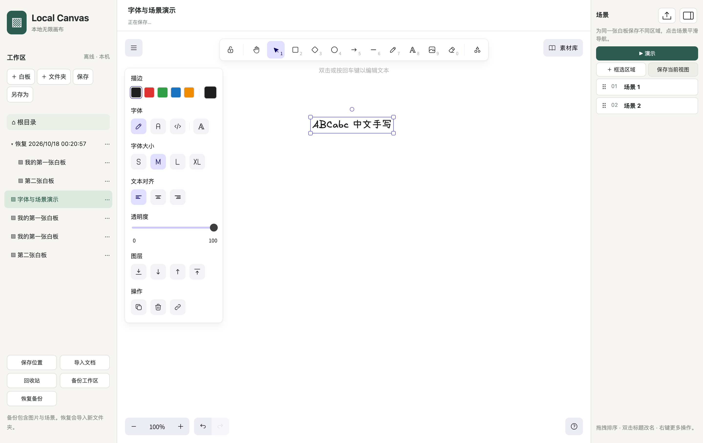

# Local Canvas · 本地无限画布

基于官方 MIT 授权的 Excalidraw React 组件，使用 React + Electron + SQLite 构建 Windows/macOS 本地优先白板。在保留原生绘图体验的基础上，增加本地文档管理、场景导航与全屏演示。

[开发源码与运行说明](https://github.com/layzerff/excalidraw/tree/codex/local-canvas-p0/desktop) · [修改清单](https://github.com/layzerff/excalidraw/blob/codex/local-canvas-p0/desktop/NEXT-ITERATION.md) · [更新记录](https://github.com/layzerff/excalidraw/blob/codex/local-canvas-p0/desktop/CHANGELOG.md) · [验证记录](https://github.com/layzerff/excalidraw/blob/codex/local-canvas-p0/desktop/VALIDATION.md) · [原版介绍](README.upstream.md)

## 与原版的区别

比较对象为上游开源编辑器及组件。原生绘图、文字、箭头、自由画笔、Frame 和撤销重做继续由官方组件提供。

| 功能 | Local Canvas 的扩展 |
| --- | --- |
| 本地文档工作区 | 嵌套文件夹与无限文档，支持创建、重命名、移动、切换和回收站，无账户及文档数量配额 |
| 自动保存与备份 | SQLite 本机保存、版本冲突保护、关闭前保存及重启恢复；完整文档与工作区备份包含图片、场景及素材库 |
| 同一白板内的场景 | 框选区域或保存当前视图，编辑标题、调整区域、拖动排序；点击后平滑移动并缩放，动画可打断 |
| 紧凑场景侧栏 | 无尺寸描述，支持拖动手柄和插入提示；双栏图标切换显示，画布自动回收宽度 |
| 导航时长 | 0.5、1.2、2.2、3.5 和 5 秒 |
| 全屏场景演示 | 按场景顺序播放，底部上一页/下一页及键盘方向键操作，退出后恢复编辑视图 |
| 演示临时画笔 | 支持颜色、粗细与清除；翻页或退出清除笔迹，原文档保持可编辑 |
| PDF 导出 | 整张白板单页或按场景顺序分页，区域裁剪；以高分辨率图片嵌入 A4 横向 PDF，适合展示与打印 |
| 字体与素材库 | 沿用画布原生字体面板，支持手写字体及离线中文回退；本地 `.excalidrawlib` 导入、合并及随文档保存 |
| 离线使用 | 编辑器资源与字体随包提供，无需连接 Excalidraw+；当前未开放云同步及在线素材库安装 |

## 编辑与场景管理



## 全屏演示


临时画笔允许连续书写多笔，翻页及退出时清除；不写入文档、备份或 PDF。编辑和备份仍使用完整文档或 `.excalidraw` 格式。

## 运行

应用代码位于 `codex/local-canvas-p0` 分支，默认分支同步说明与图片。

```sh
git clone --branch codex/local-canvas-p0 https://github.com/layzerff/excalidraw.git
cd excalidraw/desktop
npm ci --workspaces=false
npm run build
npm start
```

当前为开发版，已在 macOS Apple Silicon 验证；Windows 实机验证、发布签名及完整输入法/手写笔回归待完成。Revezone 风格的任意自定义字体上传仍在后续清单，当前提供原生中英文字体。具体完成范围见[修改清单](https://github.com/layzerff/excalidraw/blob/codex/local-canvas-p0/desktop/NEXT-ITERATION.md)。

## 上游与许可证

感谢 [Excalidraw](https://github.com/excalidraw/excalidraw)。保留 [MIT LICENSE](LICENSE)；第三方依赖及字体声明随桌面构建生成。
