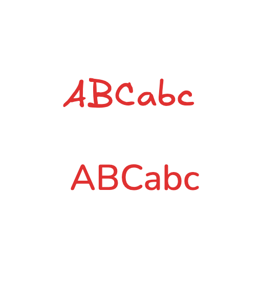

# 下次迭代需求记录

记录日期：2026-10-17。来源：用户对首个桌面开发版的反馈。

用户已要求统一实施。顶部状态表反映本轮进度，后面的原始评估保留为验收依据；细节见 CHANGELOG.md 和 VALIDATION.md。

## 本轮状态

2026-10-25 / 0.2.2：N36 自动演示循环开关与偏好持久化；N37 黑框、略大字、透明外角、连续圆角 Logo；N38 房屋与展开箭头加粗放大；N39 核实原生工具锁语义，增加不改变元素锁定属性的独立“画布只读”入口。

2026-10-25 / 0.2.1：N32 明显缩进与层级引导线；N33 当前文档全部祖先文件夹高亮，取消其他路径残留；N34 演示各面板字号统一；N35 用户参考 Logo 边框加粗加深，覆盖界面、Mac 与 Windows（含免安装版）图标。

2026-10-20 / 0.2.0：增加 N28 文件树就地菜单/拖动/展开与图标；N29 根目录及文件夹右键新建、文件夹加大加粗与工作区操作折叠；N30 双侧栏宽度调整；N31 系统文件打开/关联手动保存/另存为/文件信息及外部变更保护。文件路径不常驻左侧，自动保存继续写本机恢复副本。验收结果见 VALIDATION.md。

2026-10-18 新增调整以 N20–N25 为准；演示时长替代首轮的长时长选项。

| 编号 | 状态 |
| --- | --- |
| N01–N03 | 已实现：0.5 秒、移除尺寸描述、紧凑列表 |
| N04 | 已实现：手柄、上下半区插入、末尾落点、边缘滚动；双向真实拖拽回归通过 |
| N05 | 部分完成：恢复原生中英文手写效果，字体选择沿用画布自带面板，顶部无额外字体菜单；额外字体上传和任意字体映射尚未实现 |
| N06 | 已实现：整板单页与按场景分页、区域裁剪；当前为高分辨率位图 PDF，非矢量/可搜索文本 |
| N07 | 已实现：1:3 双栏图标切换场景侧栏、记住偏好 |
| N08 | 已实现本地导入、合并去重、随文档保存与恢复；兼容格式样例通过，未承诺所有第三方库及在线安装 |
| N09–N11 | 已实现全屏演示、翻页、临时画笔及颜色/粗细；翻页与退出清除，文档笔迹不受影响 |
| N12 | 已修复：Excalifont、Virgil、Xiaolai 离线加载验证通过；显示旧版字体 |
| N13 | 已移除场景栏导入素材库按钮，沿用画布原生素材库入口 |
| N14 | 场景改名、重框、上移、删除收进右键菜单 |
| N15 | 标题原位编辑：右键改名或双击标题，Enter/失焦提交、Esc 取消 |
| N16 | 移除场景栏总数，避免与右上角切换图标挤占位置；演示保留页码 |
| N17 | 演示画笔直接复用官方 Excalidraw 自由画笔及原生样式面板，独立临时实例不接入持久化 |
| N18 | 导出统一至右上角图标，框选区域支持 PNG、SVG、PDF；可编辑文档保持完整白板 |
| N19 | 自动保存仅响应内容/样式及场景、素材库等文档操作；平移、缩放、场景动画及结束不写入。手动保存按钮位于左侧工作区的“＋白板、＋文件夹”后面，同 Cmd/Ctrl+S 一起保存当前画布位置和缩放 |
| N20 | 演示底部“图层”打开场景面板，支持拖拽排序、右键原位改名 |
| N21 | 增加保存位置说明、工作区迁移及完整白板另存为；保留旧位置，迁移后重启启用 |
| N22 | 自动演示与手动翻页使用同一组 0.5/1/1.5/2 秒移动时长；停留默认 3 秒，到末页停止 |
| N23 | 编辑模式场景跳转固定 0.5 秒，移除其他时长选项 |
| N24 | 修复同文档重复点击导致编辑器引用被清空；加载重新挂载并检查准备状态 |
| N25 | 演示首页为当前排序的第一个场景，每次进入均从首页开始 |
| N26 | 工作区第一行新建白板/文件夹，第二行固定保存/另存为 |
| N27 | 自动演示停留时间可选 1/2/3/5/10/15/30 秒，默认 3 秒，与移动时长独立 |
| N28 | Windows x64 NSIS 安装版与免安装版已构建并检查包完整性；Windows 实机运行与代码签名尚未验证 |

新增反馈：场景侧栏切换使用 1:3 双栏图标；README 仅突出原版差异，修复细节和修改历史移至独立清单。

## 历史评估与验收依据

| 编号 | 用户需求 | 当前情况、评估与下次验收要求 |
| --- | --- | --- |
| N01 | 移动时长增加 0.5 s | 可直接增加 500 ms 选项，保留已有时长。验证移动与缩放仍同步，到达准确终点，指针、滚轮、Esc 仍能打断。工作量小。 |
| N02 | 去掉场景列表中的尺寸描述 | 删除列表内的宽 × 高文字；区域坐标与尺寸仍保存在文档内，供导航和区域调整使用。导入导出、备份恢复的数据不变。工作量小。 |
| N03 | 场景清单缩小行距，布局紧凑 | 缩小卡片间距、内边距和操作区占用，优先采用紧凑单行标题及次要操作收纳；保持长标题提示、清晰的点击目标和滚动能力。与 N02、N04 联合设计。工作量小至中。 |
| N04 | 场景条目可自由拖动排序 | 当前已有 HTML 拖拽处理，但落点仅按目标条目前插入，且没有拖动手柄、明确插入提示或末尾空白落点；此前桌面回归只覆盖“上移”按钮，没有覆盖真实拖拽。作为交互完善及缺陷排查项：支持向上/向下、首位/末位、目标上半区/下半区及长列表边缘滚动；拖拽不应误触导航。实际拖拽后切换文档、重启、备份恢复，顺序须一致。工作量中。 |
| N05 | 参考 Revezone，改善当前中英文字体效果 | 可行。Revezone 官方 README 明确支持桌面白板上传自定义字体，不能据此认定用户看到的是某一款固定字体。先分别评估应用界面字体与画布文字字体，再独立实现自定义字体或中英文搭配。具体字体尚未指定，记录为待视觉对照确认，不阻塞其他项目。验收覆盖中英混排、标点/数字、粗细与行高、换行/文本框尺寸、离线加载、Windows/macOS 一致性、图片/PDF 导出和缺字回退。不能仅覆盖界面 CSS 就宣称画布字体已调整。字体文件分发或随备份携带前核实授权；若参考 Revezone，实现时需核查其 AGPL-3.0 代码边界，并优先独立实现所需效果。工作量中至高。 |
| N06 | 文件导出可选择 PDF | 可行，目前桌面导出仅有完整 JSON 与标准 .excalidraw。建议提供“完整白板单页 PDF”和“按场景顺序分页 PDF”；完整白板按内容边界导出，各场景按保存区域裁剪。保留原有可编辑文件导出。优先评估官方 SVG 导出配合 Electron PDF 打印，核验中文/自定义字体、图片、透明背景、分页和裁剪，避免只截取当前屏幕或只生成低清截图。PDF 是阅读/打印格式，不替代包含场景元数据的可编辑备份。工作量中至高。 |
| N07 | 右侧场景列表可隐藏 | 可行。提供明确的隐藏/显示入口，隐藏后画布回收宽度，重新打开入口始终可见；记住偏好。布局变化后刷新编辑器尺寸/偏移，验证框选坐标、鼠标定位与导航终点；隐藏不删除场景。工作量小至中。 |
| N08 | 确认第三方素材库支持情况 | 官方组件提供 `.excalidrawlib` / 库 JSON 的本地导入与 `updateLibrary` 合并能力；当前应用保留原生素材库，并通过 `onLibraryChange` 保存到文档，随完整文档与备份携带。当前 HTTP/WebSocket 与新窗口被阻止，因此在线浏览/一键安装尚不支持。本地第三方库导入具备组件基础，但首轮回归未实际导入第三方库，不能记为已验收。下次明确本地导入入口并补测：导入真实 `.excalidrawlib`、合并/去重、放置素材、切换/重启、备份恢复、自定义字体与图片依赖。在线浏览/安装单列后续增强，不因本次确认自动开放网络。其他软件原生素材格式不承诺直接兼容；逐库核查使用与分发许可。工作量：本地验证与入口中，在线安装另评估。 |
| N09 | 场景列表增加“演示”按钮，点击进入全屏演示 | 可行，新增独立演示状态。进入系统全屏，隐藏文件树、场景侧栏与常规编辑工具，按场景列表顺序展示。建议从当前场景开始，没有当前场景时从第一项开始；无场景时给出创建提示。全屏布局稳定后重新计算视口，沿用移动时长及可打断导航。提供退出入口与 Esc 退出，退出后恢复原布局及进入前视图；恢复规则列为建议默认值，尚非用户明确指定。验收覆盖进入/退出、系统全屏变化、尺寸更新、空列表和动画中退出。工作量中。 |
| N10 | 全屏演示底部显示左右箭头和一次性画笔按钮 | 底部浮动工具栏保持可发现、可点击，提供上一场景、下一场景及临时画笔入口；建议附当前页/总页数及退出按钮。翻页遵循用户排序，默认首尾不循环、到边界禁用对应按钮；键盘左右方向键与按钮行为一致。工具栏操作不能误画到画布。是否自动隐藏工具栏尚未指定，首版建议常显。工作量中，与 N09、N11 同时实现。 |
| N11 | 一次性画笔可改颜色和笔画粗细，参考内置画笔风格与菜单 | 将“克重”理解为笔画粗细/线宽。提供颜色与粗细选择，视觉及操作参考现有内置自由画笔的菜单和笔迹风格；允许连续画多笔，非默认画完一笔即退出。建议采用独立临时批注层，以隔离自动保存、原生撤销记录和文档导出。建议翻页或退出演示时清除本页临时笔迹，并提供手动清除入口；临时笔迹不进入白板文件、备份或 PDF。这些生命周期规则是对“一次性”的建议解释，用户尚未明确指定。颜色/粗细偏好可独立保存。验收覆盖多笔、中途调色/粗细、翻页、Esc/退出、动画与缩放后的笔迹坐标、重启无临时笔迹，以及原始文档未被改写。工作量中至高。 |
| N12 | 恢复 Excalidraw 原生手写字体，保留标准字体选择 | 已复现原生字体加载故障，作为优先缺陷修复，区别于 N05 新增自定义字体。2026-10-17 在隔离 Electron 窗口中对 `ABCabc` 调用字体加载，Excalifont 与 Virgil 均报 `A network error occurred.`；对应字体文件实际已随包复制。需排查离线资源 URL 与加载初始化时机，确保从本地文件成功加载，不依赖 CDN。另：官方 0.18.1 将 Virgil 标为 deprecated，当前宿主未传 `showDeprecatedFonts`，需评估恢复其菜单入口，同时保留现代 Excalifont 和标准字体。用户参考图用于区分手写与标准效果，不能仅凭图断言具体字体名称。验收：字体加载状态为 loaded、`ABCabc` 手写/标准效果明显不同，英文数字标点与中文回退正常，既有文字不被强制改字体，切换/重启与图片/PDF 导出保持一致；源码与打包应用均需验证。本轮只诊断记录，尚未修复或重新打包。 |

## 原生手写字体反馈图（N12）

此图为用户提供的效果参考，不是修复后的应用截图。优先恢复原生字体，再推进 N05 的额外中英文字体定制。

## 演示功能补充约定（建议默认，实施前可调整）

- 用户已明确要求：演示按钮、进入全屏、底部左右箭头与一次性画笔、画笔颜色和粗细菜单。
- “一次性”暂解释为演示中的临时批注：允许连续绘制，翻页或退出时清除；不写入文档或导出。若用户后续要求保留到整场结束、淡出笔迹或画一笔后退出，应更新此规则。
- 画笔菜单打开时，Esc 优先关闭菜单；之后 Esc 退出演示。退出全屏、切换文档或窗口关闭也应结束演示并清理临时状态。
- 场景切换、全屏尺寸更新与临时批注必须一起验证；不能仅复用原生画笔后任由自动保存把演示笔迹写入原文档。

## 建议实施顺序

1. 优先处理 N12 原生手写字体加载缺陷及旧版字体可选性，再一起处理 N01、N02、N03、N04、N07，完成场景面板的紧凑布局、拖拽和隐藏体验。
2. 联合处理 N09、N10、N11，完成全屏演示、顺序翻页和临时批注，复用已完善的场景导航。
3. 处理 N08 本地素材库兼容与持久化验证。
4. 确认 N05 字体方案后实施，并与 N06 PDF 输出联合验证，减少字体渲染和导出返工。

## 当前证据与参考

- 当前实现：`src/main.jsx` 中的 `duration`、场景拖拽、尺寸文本、`onLibraryChange`；`src/style.css` 中的界面字体栈和场景布局；`electron/main.cjs` 中的文档导出及离线限制。
- 当前安装的官方 Excalidraw 0.18.1 包包含 `.excalidrawlib` / JSON 本地库文件导入处理；应用层尚未完成第三方库导入专项验收。
- [Excalidraw 官方 API：updateLibrary](https://docs.excalidraw.com/docs/@excalidraw/excalidraw/api/props/excalidraw-api#updatelibrary)
- [Excalidraw 官方公共素材库目录](https://libraries.excalidraw.com/)
- [Revezone：Custom Fonts in Excalidraw Board](https://github.com/revezone/revezone#custom-fonts-in-excalidraw-board)

后续继续更新顶部状态表和验证记录。原始评估中的“尚未实施”描述为历史记录，以本轮状态为准。
